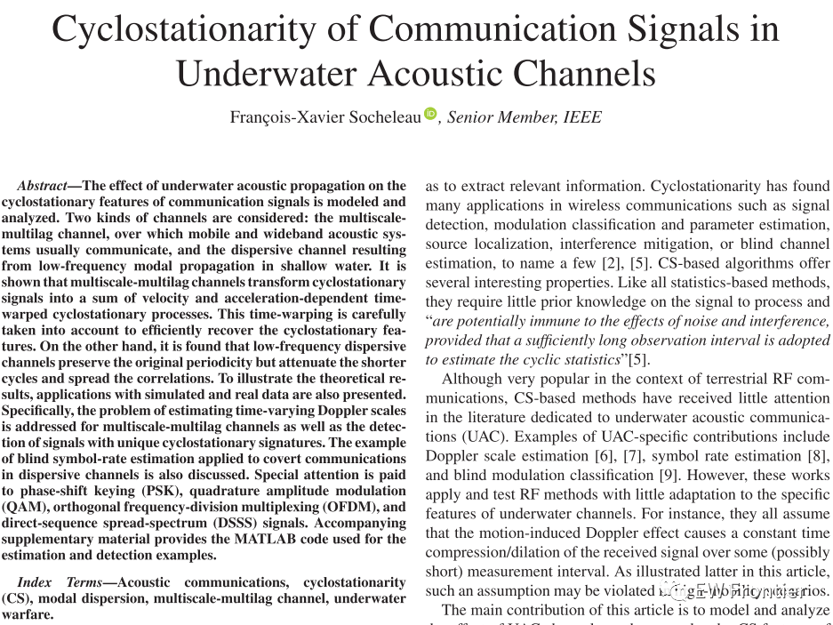
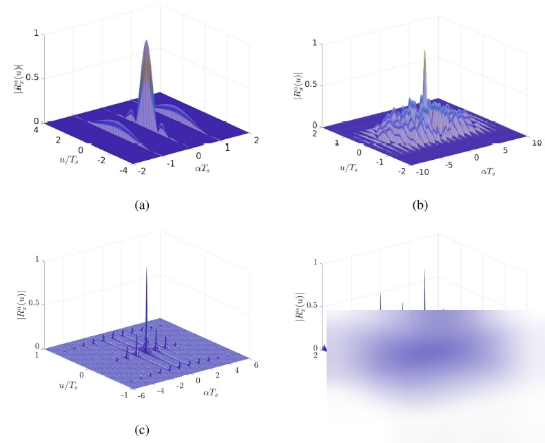
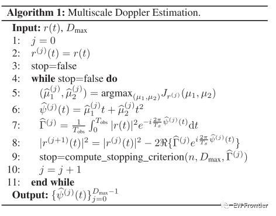
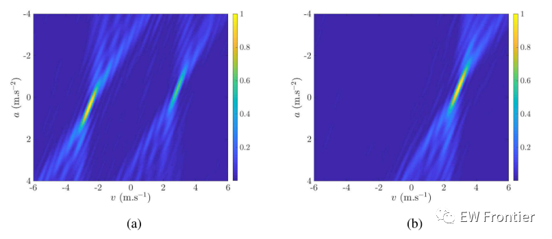
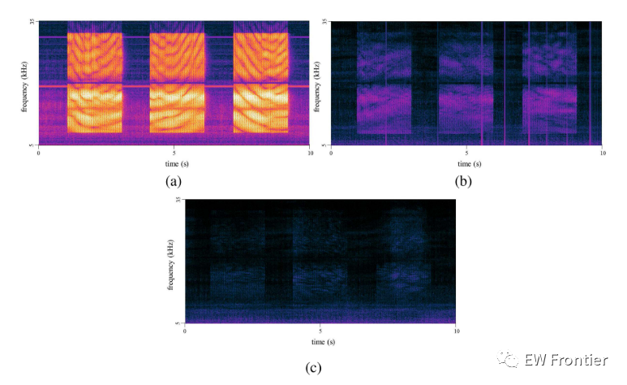
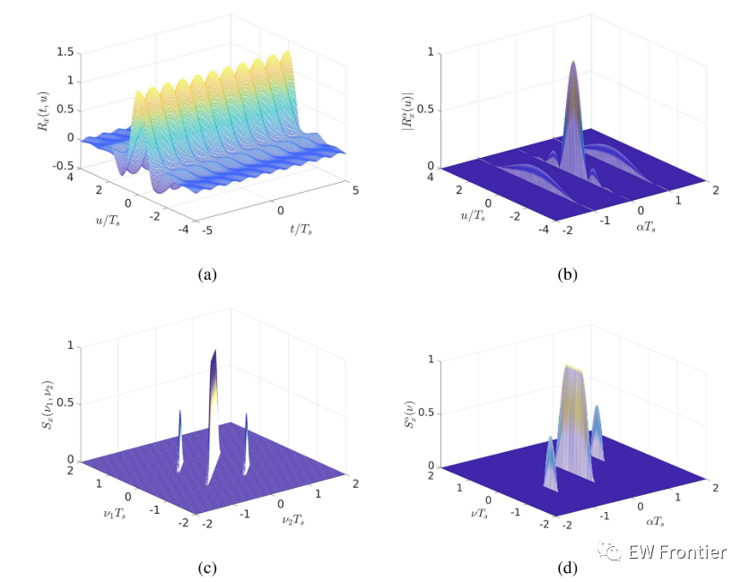
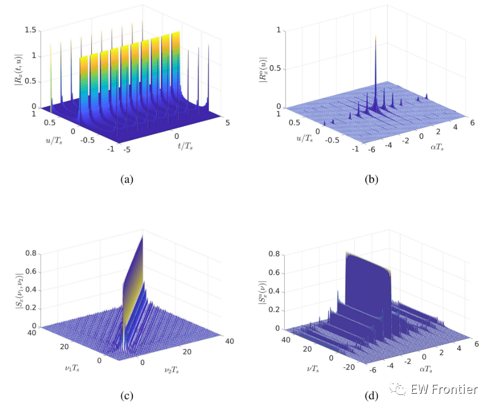
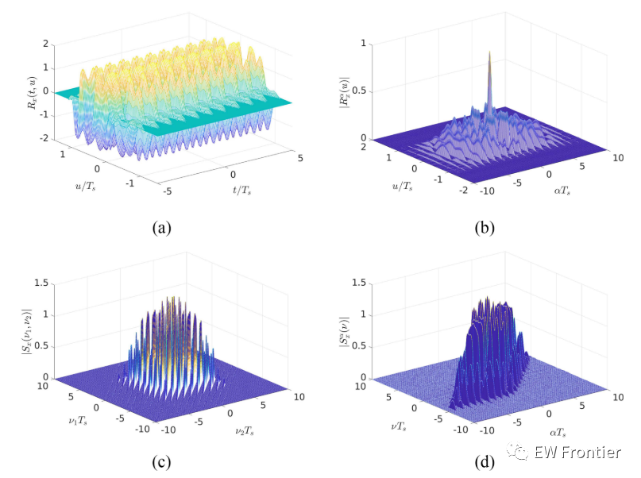

# [Underwater Acoustic Signal Analysis]The Cyclic Stable Characteristics of Communication Signals in Underwater Channels[With MATLAB Code]

Abstract: This study models and analyzes the impact of acoustic propagation on the cyclic stability characteristics of communication signals. Two types of channels are considered: multi-scale multi-lag channels, where mobile and broadband acoustic systems typically communicate, and dispersion channels that cause low-frequency modes to propagate in shallow water. It demonstrates the sum of the velocity and acceleration-dependent time warping of cyclic stable signals transformed by multi-scale multi-lag channels. This temporal distortion is carefully considered to effectively restore cyclic stability features. On the other hand, it has been found that low-frequency dispersion channels maintain their original periodicity but exhibit shorter decay periods and reduced correlation in propagation. To illustrate the theoretical results, applications of simulations and real data are proposed. Specifically, the problem of estimating time-varying Doppler scales is addressed for both multi-scale multi-lag channels and the detection of unique cyclic stable signal characteristics. Finally, an application example of blind code rate estimation in dispersion channel concealed communication is provided. Special attention is given to phase-shift keying (PSK), quadrature amplitude modulation (QAM), orthogonal frequency division multiplexing (OFDM), and direct sequence spread spectrum (DSSS) signals. Supplementary materials provide MATLAB codes for estimating and detecting examples.
Acoustic communication, cyclic stability (CS), mode dispersion, multi-scale multi-lag channels, underwater combat.
To facilitate the use of CS-based methods in UAC environments and to illustrate the theoretical results, applications of simulations and real data are also provided. Two experiments were conducted in a multi-scale multi-lag MSML channel in a dispersion channel.
1) In the first experiment, the estimation of time-varying Doppler scales caused by strong acceleration was considered. This paper proposes a method for estimating multiple Doppler scales in multipath channels and evaluates it on simulated phase-shift keying (PSK)/Quadrature Amplitude Modulation (QAM) signals. The method utilizes the CS characteristics that become temporally distorted due to Doppler scaling. Specifically, a quadratic function of time is used to model the Doppler caused by motion, and a cost function is derived based on the autocorrelation properties. Then, this cost is iteratively optimized to estimate polynomial coefficients related to the speed and acceleration of each path. It does not affect data rate and is suitable for non-cooperative scenarios.
2) The second application addresses the problem of detecting UAC signals with specific CS signatures. Such signatures may be unique, thus relevant to the detection of given communication systems in underwater warfare applications. A statistical test explicitly considers the derivation of Doppler scales that vary with time. This test provides reasonable complexity and its performance is demonstrated to be better than existing RF methods through data collected in shallow water MSML channels of an Orthogonal Frequency Division Multiplexing (OFDM) system. It has been proven to provide better performance compared to off-the-shelf RF methods.
3) The last experiment is a specialized issue, blind symbol rate estimation for direct sequence spread spectrum (DSSS) transmission over dispersion channels. Such an issue could be critical for eavesdropping on low frequency concealed communications. Compared to MSML channels, dispersive channels do not distort the CS functionality, making estimation already needed in literature minimal. An estimator is proposed and replay simulations are conducted using real low frequency single input multiple output (SIMO) shallow pulse responses. Results show that spatial coherence along the array significantly improves the estimated rate.
Most communication signals are circularly stable, with their period equal to the symbol period Ts. This is illustrated in Figure 1 using the cyclic autocorrelation functions of four types of signals commonly used in underwater acoustic communication: PSK/QAM [14], [15] (left upper), short code DSSS [16], [17], [18] (right upper), circular prefix OFDM (CP-OFDM) [19], [20], [21] (left lower) and SIP-OFDM with added pilots [22] (right lower). Each signal has its own CS mode, which is useful for blind modulation identification, and each pattern reveals the value of this symbol period Ts. As further discussed and explained in Appendix A, due to the reuse of the same pulse shaping filter, the same spread spectrum or pilot sequence, or the redundancy caused by the circular prefix, such signals exhibit periodic second-order statistics. Other types of UAC waveforms, such as MFSK, frequency hopping FSK (as used in JANUS standard [23]) or chirped spread spectrum are also second-order CS [24], [25]. Although not discussed in this article, the application examples introduced in the next section can easily be converted into these non-coherent modulation schemes. Finally, besides data symbols, UAC signals typically include signaling modes, such as pseudo codes that generate additional CS characteristics, post-synchronization codes or time-frequency pilots [26], [27]. In this case, the cyclic frequency may be asymmetrical, and the signal is referred to as nearly CS [4]. To avoid relying on specific frame structures, the methods introduced in the rest of this article only utilize the information provided by the cyclic frequency multiplied by the symbol rate.
Figure 1. Examples of cyclic autocorrelation functions. (a) PSK/QAM with root raised cosine filter. (b) Short code DSSS with 7 chip length spread spectrum sequence and root raised cosine filter. (c) CP-OFDM with root raised cosine window. (d) SIP-OFDM with rectangular window.
The previous answer still contains Chinese characters (Figure / Examples show the evolution of the cost function Jr(j) in the simulated / channel based / model with iterations). Translate those Chinese parts into English as well, then output the complete English text only.

Figure 7. An example of the evolution of the cost function Jr(j) obtained in the MSML channel using Bellhop simulation. (a) Iteration j =0, (b) Iteration j = 1. The cost is represented as a function of the model (8) based on speed and acceleration, where c = 1500 m/s, that is, v = 1500 (1 − μ1), a = −3000μ2. Tobs =1 s, Ts =0.2 ms, fc =20 kHz, Eb/N0 =5 dB.  
See Figure 9. Spectral diagram of the OFDM data packet received. (a) High SNR data packet with tone noise. (b) Middle SNR data packet with pulse noise. (c) Low SNR data packet.  
Figure 19. Cyclic stationary characteristics of PSK/QAM signals with root mean square raised cosine filter g=0.5. (a) Autocorrelation function, (b) Cyclic autocorrelation function, (c) Spectral correlation function, and (d) Cyclic spectrum.  
Figure 20. Cyclic stationary characteristics of ZP-OFDM signals with Ts = Ts/4, N =32 and a rectangular window. (a) Autocorrelation function, (b) Cyclic autocorrelation function, (c) Spectral correlation function, and (d) Cyclic spectrum.  
Figure 21. Cyclic stationary characteristics of DSSSS signals with maximum length extension sequence Nc =7, root raised cosine filter g, where k =0.5. (a) Autocorrelation function, (b) Cyclic autocorrelation function, and (c) Spectral correlation function, (d) Cyclic spectrum.

## Images

<!-- PAYMENT_BLOCK -->

## Get this dataset

- Payment link (Stripe): [Buy now](https://buy.stripe.com/3cs8yP7sY87d0vu9AB)
- Payment QR code: 

<!-- /PAYMENT_BLOCK -->
